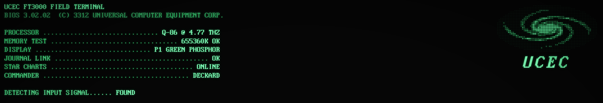
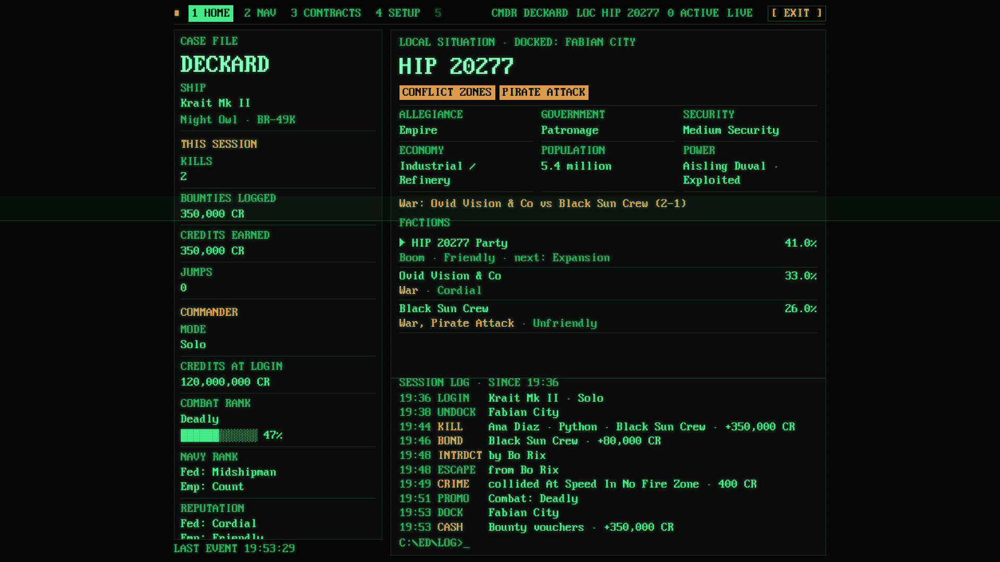
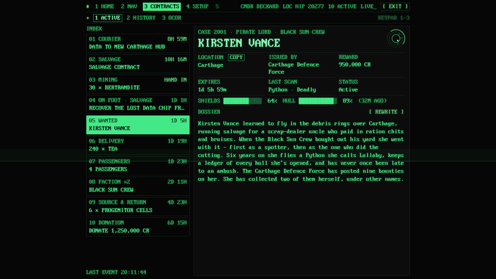
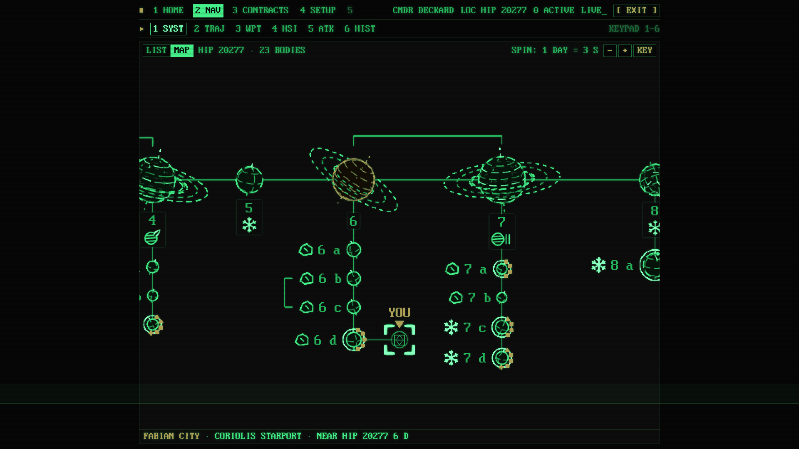
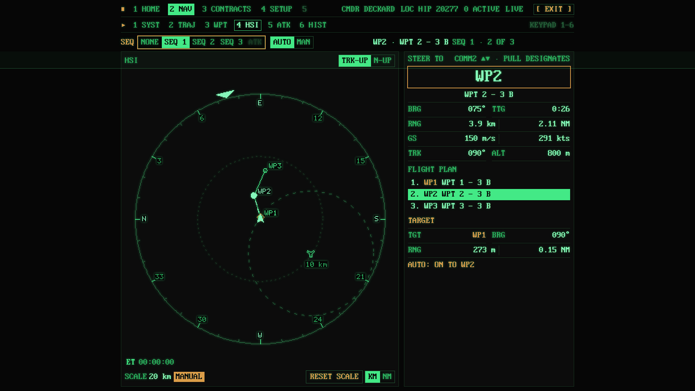
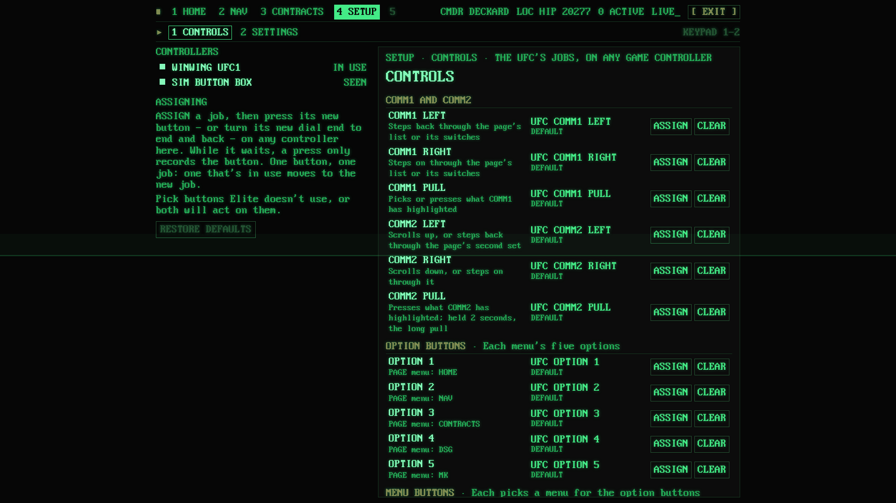
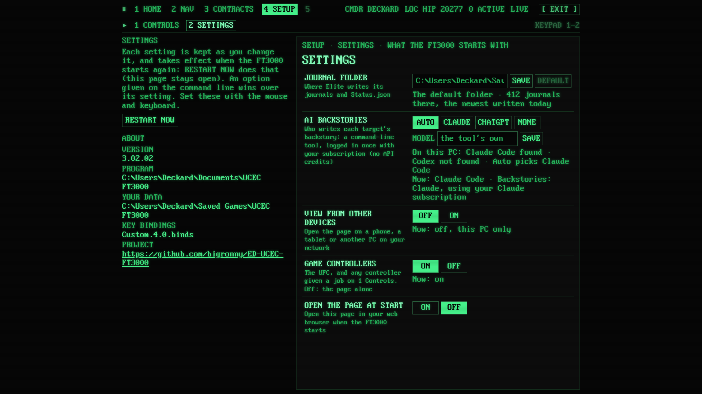

# UCEC FT3000

**A field terminal for Elite Dangerous.** UCEC FT3000 reads your game's journal as you play and turns it into a
green-phosphor terminal in your web browser: your missions and the people you've been sent after (each with a short
backstory written by an AI), the system you're in, navigation and attack tools for flying low over a planet, and your
history. It also runs a **WinWing UFC** for Elite - menus on the UFC's displays, and buttons that press your Elite key
bindings - so the whole thing can be worked from the UFC alone, in VR, with Elite keeping the focus.

In the game's fiction it is a field terminal from the Universal Computer Equipment Corporation.

> UCEC FT3000 is a fan-made tool. It is not made, endorsed or supported by Frontier Developments. See
> [Not affiliated](#not-affiliated).

## What it does

**1 Home** - your case file: ship, ranks, reputation, this session's kills, bounties and credits, and the session log.



**3 Contracts** - the missions you hold, soonest to expire first. Each target gets a dossier: who issued it, the
reward, their ship and rank from your last scan, shields and hull - and a backstory. History lists what you've
completed, failed or abandoned; OCOR takes your squadron's daily BGS briefing, pasted from Discord.



**2 Nav > Syst** - the system you're in (or any you pick to plan in): its bodies, stations, settlements and signals,
as a list and as a map, from Spansh and EDSM plus your own journal. Odyssey settlements have schematic plans, with
their doors, terminals and loot.



**2 Nav > Traj, Wpt, HSI, Atk** - navigation built loosely on the F/A-18C Hornet's: waypoints and marks on a planet's
surface, flight plans, an HSI with AUTO sequencing and a stopwatch / countdown timer, designated targets, guidance
down to a planetary facility, and a 2-ship pop-up attack plan with a mine-release computer.



**4 Setup > Controls** - every UFC job can be put on any game controller's button or dial: a button box, a HOTAS, a
joystick. The UFC's own layout is the default.



**4 Setup > Settings** - your journal folder, which AI writes backstories, viewing the page from a phone or another
PC, the game controllers.



## What you need

- **Windows 10 or 11**, and **Elite Dangerous** (Odyssey for the on-foot and settlement features).
- A **web browser** (Edge, Chrome or Firefox) - the terminal is a web page served from your own PC.
- **Optional - a WinWing UFC**, with **WinWing SimApp Pro** running (it draws the UFC's text). Without a UFC, the
  page works with the mouse and keyboard, and any other game controller can drive its menus (4 Setup > Controls).
- **Optional - backstories**: a command-line AI tool, logged in once with your **subscription** - no API key, no
  pay-per-use credits:
  - **Claude Code**, with a Claude subscription that includes it (Pro or Max), or
  - **Codex CLI**, with a ChatGPT plan.

  Without either, everything else works; targets just have no backstory.
- **Optional - an internet connection**, for system data from Spansh and EDSM. Without it, the Nav pages show what
  your own journal knows.

## Installing and starting it

1. Download the latest `UCEC-FT3000-<version>.zip` from the
   [Releases page](https://github.com/bigronny/ED-UCEC-FT3000/releases) (under *Assets*).
2. Before unzipping it: right-click the zip, choose **Properties**, tick **Unblock** if it's there, and press OK.
   (Windows marks files downloaded from the internet; unblocking the zip saves it asking about each file inside.)
3. Unzip it anywhere - your Documents folder is fine. Everything it needs, Python included, is inside: there's
   nothing else to install.
4. Double-click **Start UCEC FT3000** in the `UCEC FT3000` folder. A console window opens (that's the FT3000
   running - leave it open) and the terminal opens in your browser at <http://localhost:8642/>. If Windows warns
   you first - that it protected your PC, or that the publisher couldn't be verified - choose **More info**, then
   **Run anyway** (or just **Run**): the launcher isn't from a publisher Windows knows.
5. The terminal switches on, runs its BIOS checks and waits for the game. Start Elite; once you're in your ship,
   SRV or on foot, it shows the case file. Tap the screen or press Esc to skip the start-up.

To stop it: press **[ EXIT ]** on the page, or close its console window. Closing the browser tab alone leaves it
running - starting it again closes the old copy first, so that's harmless.

**Updating**: unzip the new version over the old one, or anywhere else. Your data isn't in the program's folder (see
below), so nothing is lost.

### Running it from source

If you'd rather run the Python script yourself: get the source (the green **Code** button on the
[project page](https://github.com/bigronny/ED-UCEC-FT3000), or the *Source code* zip on a release), install
Python 3.8 or later, then

```
pip install hidapi
python ed_target_board.py
```

`hidapi` is only needed for the UFC and other game controllers. Keep the `web` and `schematics` folders next to the
script. `python ed_target_board.py --help` lists the command-line options; anything given there wins over its
setting on the page.

## Your data

Everything you build up - waypoints, flight plans, settlement layouts you've confirmed, backstories, system data,
your controls and settings - is kept in **`Saved Games\UCEC FT3000`** in your user folder, apart from the program.
4 Setup > Settings shows where. To back it up, copy that folder.

The FT3000 only **reads** your journal files; it never changes them, and it doesn't read the game's memory.

## Using the UFC

Keys are looked up in your Elite bindings by action, so the UFC follows if you rebind something in the game. They're
only sent while Elite is the active window. Each button presses a **keyboard** key: an action you've only bound to a
joystick can't be pressed from the UFC.

| UFC | What it does |
|---|---|
| **ILS** | The page menu. Option buttons 1-3 pick the tabs (HOME, NAV, CTRS) - pressed again, the next sub-tab. **4 DSG** designates what's highlighted; **5 MK** marks where you are. The keypad picks a sub-tab (Nav: 1 Syst, 2 Traj, 3 Wpt, 4 HSI, 5 Atk, 6 Hist). |
| **D/L** | Navigation: galaxy map, system map, next route system, supercruise, jump. |
| **BCN** | Wing: target wingmen, wing nav-lock, wingman's target. |
| **IFF** | Targeting: next / previous target, next / previous hostile, highest threat. |
| **AP, TCN** | Fighter orders. |
| **ON/OFF** | Cargo scoop, night vision, landing gear, hide HUD, HUD mode. |
| **IP** | Requests docking. |
| **COMM1 knob** | Moves through the list on the page (contracts, bodies, objectives, waypoints); pull to select. |
| **COMM2 knob** | Scrolls the right-hand panel and steps through its buttons; a short pull presses. |
| **COMM1 VOL, COMM2 VOL, BRT dials** | Zoom, spin / pan and tilt the map, planet and schematic pictures. The middle of each dial holds still; turn it further for faster. |

Other controllers: **4 Setup > Controls** - press ASSIGN beside a job, then the button (or turn the dial end to end
and back) on any controller. RESTORE DEFAULTS puts every job back on the UFC. Pick buttons Elite doesn't use.

If Elite runs as administrator, run the FT3000 as administrator too, or Windows blocks its key presses.

## Backstories

Each target you're sent after gets a short backstory, written once by your AI tool and kept, so restarting doesn't
spend your allowance again. **[ REWRITE ]** on a dossier asks for a new one.

To set it up, install one of the tools and log in once with your subscription account:

- **Claude Code**: install it (see Anthropic's instructions), run `claude` in a terminal and log in with your Claude
  account.
- **Codex CLI**: install it, run `codex login` and choose *Sign in with ChatGPT*.

Then, in **4 Setup > Settings**, leave AI BACKSTORIES on **AUTO** (Claude Code if it's on your PC, else Codex) or pick
one, and press RESTART NOW. The page says which tools it found and whether the login check passed. If a tool is
signed in with an API key instead (which bills pay-per-use credits), the FT3000 pauses backstories and says how to
switch to your subscription.

## Viewing it on a phone or another PC

Turn on **VIEW FROM OTHER DEVICES** in 4 Setup > Settings and press RESTART NOW. The page then shows the address to
open on the other device (something like `http://192.168.1.20:8642/`), which must be on the same network. On a
phone, "Add to Home Screen" gives it the full screen. The first time, Windows may ask whether Python can use the
network: allow it on **private** networks.

The page has no password: anyone on your network can open it, and press keys in Elite with it. Only turn this on at
home, on a network you trust. With it off (the default), only your own PC can reach the page - and either way, the
FT3000 refuses requests from other websites open in your browser.

## Troubleshooting

| Problem | Try |
|---|---|
| The BIOS screen says *Journal link: No journal*, or the page shows nothing about your game | Check JOURNAL FOLDER in 4 Setup > Settings: it should be where Elite writes `Journal.*.log` (normally `Saved Games\Frontier Developments\Elite Dangerous`). It shows how many journals it finds there. |
| *Couldn't start the web server on port 8642* | Another program has that port. Run with `--port 8700` (and open <http://localhost:8700/>). |
| The UFC's displays stay blank | SimApp Pro must be running. The displays stay blank until the page is open and the terminal has started up - that's on purpose. |
| UFC buttons don't do anything in the game | Elite must be the active window. Run with `--list-keys` to see what each button presses: `** NO KEYBOARD BINDING **` means that action needs a keyboard key in Elite's controls. Elite as administrator: run the FT3000 as administrator too. |
| The UFC's dials don't answer | ASSIGN them on 4 Setup > Controls (turn each end to end and back), or run once with `--ufc-learn`. |
| No backstories | 4 Setup > Settings says which tools it found and how the login check went (see [Backstories](#backstories)). |
| A phone can't open the page | VIEW FROM OTHER DEVICES on, and restarted? Same network? Allow Python through the Windows firewall on private networks. |
| System data missing on Nav > Syst | The SPANSH and EDSM UPLINK switches on the system list must be on, and you need an internet connection. |
| The pictures are jerky | Start it with **Timing log.bat** (or `--timing-log`), fly for a minute, and send `timing_log.jsonl` from your data folder with your report. |

Report problems on the project's [Issues page](https://github.com/bigronny/ED-UCEC-FT3000/issues): say which
version you're running (it's on the BIOS screen, 4 Setup > Settings, and the console), and copy what the console
window says.

## Credits

- Typeface: *Px437 IBM VGA 8x16* from the [Ultimate Oldschool PC Font Pack](https://int10h.org/oldschool-pc-fonts/)
  by VileR, [CC BY-SA 4.0](https://creativecommons.org/licenses/by-sa/4.0/), included unmodified.
- Settlement measurements - positions, doors, terminals, loot and combat-zone points:
  [SrvSurvey](https://github.com/njthomson/SrvSurvey) by CMDR Grinning2001 (njthomson) and contributors (GPL-3.0). Settlement layout names
  and pad counts: [Raven Colonial](https://ravencolonial.com). The schematic plans were traced from CMDR Quizengine's
  [Odyssey settlement maps](https://elitedangereuse.fr/outils/quizengine/omg_1.1.html) (OMG, now hosted by Elite
  Dangereuse).
- System data: [Spansh](https://spansh.co.uk) (bodies, stations, signals and coordinates, from players' EDDN
  uploads) and [EDSM](https://www.edsm.net) (traffic, deaths, exploration value). How the sources are combined
  follows [EDDiscovery](https://github.com/EDDiscovery/EDDiscovery). The FT3000 identifies itself to both by name
  and version, and asks only about systems you're in or look at.
- The release zip includes Python and hidapi, under their own licences.

The full list is in [CREDITS.md](CREDITS.md).

## Licence

UCEC FT3000 is free software, under the GNU General Public License v3.0: see [LICENSE](LICENSE).

## Not affiliated

Elite Dangerous is © Frontier Developments plc. UCEC FT3000 is an unofficial, fan-made tool; it is not made,
endorsed or supported by Frontier Developments. It reads the journal files the game writes for tools like it, and
presses keys you've bound - it doesn't change the game or read its memory. WinWing, SimApp Pro, Claude, Claude Code,
ChatGPT and Codex are trademarks of their owners.

## Changes

See [CHANGELOG.md](CHANGELOG.md).
